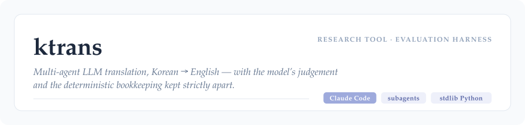
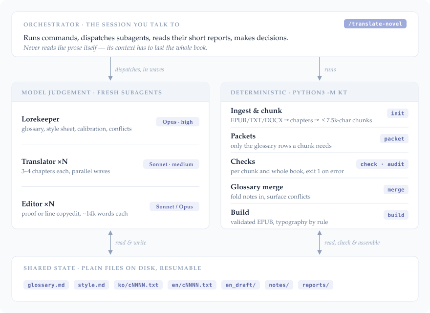
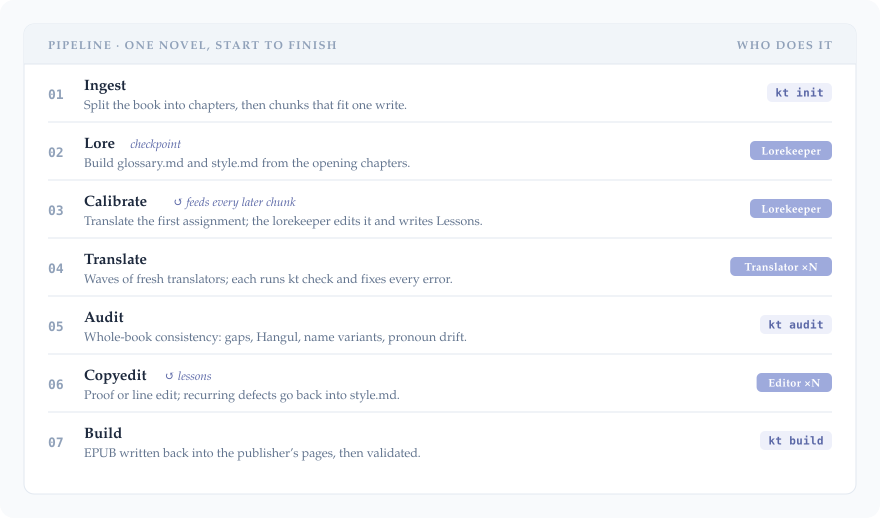

<p align="center">
  <picture>
    <source media="(prefers-color-scheme: dark)" srcset="docs/assets/header-dark.svg">
    
  </picture>
</p>

<p align="center">
  <a href="https://github.com/beadvd/ktrans/actions/workflows/tests.yml"></a>
  
  
  <a href="LICENSE"></a>
</p>

<p align="center"><sub>
  <a href="#architecture">Architecture</a> ·
  <a href="#design-decisions">Design decisions</a> ·
  <a href="#setup">Setup</a> ·
  <a href="#usage">Usage</a> ·
  <a href="#evaluation">Evaluation</a> ·
  <a href="#tests">Tests</a> ·
  <a href="#how-it-was-built">How it was built</a>
</sub></p>

---

**ktrans** is a research tool for **multi-agent LLM translation of long-form
fiction, and for evaluating it automatically**. It asks three questions. How
should book-length translation be split between agents with different jobs?
Which steps should a model never do? And what can be measured without a
human reading every line?

The test case is Korean → English, because Korean is hard on single-pass
machine translation. Third-person gender is rarely marked. Formality lives in
verb endings. Western names arrive in Hangul. And a 300-chapter book has to
keep every name, pronoun and voice the same from the first page to the last.

It runs inside [Claude Code](https://docs.claude.com/en/docs/claude-code).
A thin orchestrator dispatches specialised subagents. A standard-library
Python toolkit (`kt`) does every deterministic step and checks every output.

> [!NOTE]
> The repository contains **no source texts and no translations**, apart
> from one sentence of public-domain Korean and its translation quoted in the
> Evaluation. Working files live in `novels/`, which is git-ignored. Use public-domain texts or
> texts you have the rights to; the [demo](#usage) uses public-domain Korean
> fiction.

## Architecture

<p align="center">
  <picture>
    <source media="(prefers-color-scheme: dark)" srcset="docs/assets/architecture-dark.svg">
    
  </picture>
</p>

<p align="center">
  <picture>
    <source media="(prefers-color-scheme: dark)" srcset="docs/assets/pipeline-dark.svg">
    
  </picture>
</p>

| Component | Where | Role |
|---|---|---|
| Orchestrator | [`.claude/skills/translate-novel/SKILL.md`](.claude/skills/translate-novel/SKILL.md) | Runs the phases, dispatches waves, reads reports, decides |
| Lorekeeper | [`.claude/agents/novel-lorekeeper.md`](.claude/agents/novel-lorekeeper.md) | Owns `glossary.md` and `style.md`; calibrates; resolves conflicts |
| Translator | [`.claude/agents/novel-translator.md`](.claude/agents/novel-translator.md) | Translates assigned chunks, runs `kt check`, reports new terms |
| Editor | [`.claude/agents/novel-editor.md`](.claude/agents/novel-editor.md) | Proof or line copyedit; reports recurring defects |
| Toolkit | [`kt/`](kt) | Ingest, chunking, packets, checks, glossary merge, EPUB build |

## Design decisions

### Deterministic code vs. model judgement

Anything with a right answer that can be computed is done by code: splitting
chapters, numbering paragraphs, counting, merging glossary rows, curling
quotes, normalising ellipses, assembling and validating the EPUB. Models are
used only where judgement is needed: meaning, register, voice, and which of
two readings a scene supports.

Models are unreliable at bookkeeping and confident when they get it wrong.
In an earlier workflow the model wrote JSON with every quote escaped, kept
inline markers aligned and normalised punctuation itself. Now it writes
plain `[[n]] English` lines, and the toolkit does the rest and checks the
result. A prompt *asks* a model to behave; `kt check` *asserts* that it
did, and an `ERROR` means the chunk is not done.

### Model choice per role

Each role gets the model and effort its risk profile calls for, set in each
agent's front matter.

| Role | Model | Why |
|---|---|---|
| Translator | Sonnet, medium effort | Most of the volume. Sonnet at medium effort is strong at this, and its typical risks (pronouns, terms, voice) are covered by the glossary, the calibration lessons and the checks. |
| Lorekeeper | Opus, high effort | Little volume, all judgement: pronoun evidence, romanisation, telling a plot reveal from an error. Its mistakes spread to every later chapter. |
| Editor | Sonnet for a proof pass, Opus for a line edit | Chosen per book after calibration. A line edit is where the larger model is noticeably better. |
| Orchestrator | any; Sonnet is enough | It only runs commands and dispatches. |

The working rule: higher effort on translation mostly buys longer thinking,
not better English. Spend the extra on a line edit instead.

### Fresh subagents to manage context

A single long session that translates chunk after chunk fills its context,
and early material is gradually "half-forgotten". So every batch goes to a
**fresh subagent** with a self-contained brief, and the orchestrator never
reads prose, only short reports.

Context is sized on purpose:

* **Chunks** are at most 7,500 Korean characters. That is about one
  web-novel chapter, so chunk boundaries fall on chapter boundaries. The
  English fits comfortably in one response, and the model is still attending
  to line 1 when it writes the last line.
* **Packets** carry only the glossary rows whose Korean occurs in the chunk,
  plus a short tail of the previous chunk's English so the voice carries
  across the seam.
* **The generic brief** is the agent's system prompt, written once rather
  than pasted into every chunk.

Because all state is plain files, a run interrupted by a usage limit resumes
by looking at what exists.

### Calibration loop

Before the bulk of the book, the first assignment (about three chunks;
a chapter's parts are never split across translators) is translated. The lorekeeper
then edits them against the Korean and turns every defect that could recur
into a one-line rule under **Lessons from review** in `style.md`. Every later
translator reads those lessons.

The loop keeps running. Editors report recurring defects, and the lorekeeper
folds them back into the same section, so later batches benefit. In the
[pilot evaluation](#evaluation), calibration made 57 meaning-level fixes to
chunks that had passed every mechanical check. Whether its lessons improve
*later* chunks is the open question the next round of evaluation targets.

### Automated checks

`kt check` runs on every chunk straight after it is written, and `kt audit`
runs on the whole book.

| Level | What is caught |
|---|---|
| Structure (`ERROR`) | missing, extra, duplicate or out-of-order paragraphs; stray lines; empty segments |
| Leakage (`ERROR`) | surviving Hangul; translator notes; pronoun metadata like "(he)" in prose; Markdown; broken `{i}` markup |
| Repetition (`ERROR`) | a sentence or paragraph repeated, or echoed from a neighbouring segment |
| Consistency (`WARN`) | glossary terms not used; name variants (Lucas / Lukas); pronoun drift across chapters; heading format |
| Style (`WARN`) | length ratio (dropped clauses); em-dash rate; tildes; unpunctuated dialogue; CJK brackets |
| Translationese (rate) | 17 over-produced phrases ("couldn't help but", objectless "welled up"…), per 10,000 words |

The checks can't judge accuracy or prose; that's what the editor pass is
for. Every `kt check` run is also appended to `reports/check_log.jsonl`, so
what the checks caught can be measured afterwards (see
[Evaluation](#evaluation)).

## Setup

Requirements: Python 3.10+ and Claude Code. The toolkit uses only the
standard library, so there is nothing to install to run it.

```bash
git clone https://github.com/beadvd/ktrans.git
cd ktrans
python3 -m pip install pytest      # only for the tests
```

Optional: install [epubcheck](https://www.w3.org/publishing/epubcheck/)
(`brew install epubcheck`, or set `EPUBCHECK_JAR=/path/epubcheck.jar`), and
the build runs the official validator as well as its own checks.

If `ANTHROPIC_API_KEY` is set in your shell, Claude Code bills that key
instead of your subscription. Unset it first if that isn't what you want.

## Usage

Open the folder in Claude Code (terminal, desktop app or IDE extension) and
give it a file (`.epub`, `.txt`, `.docx`, `.html`, `.md`):

```text
/translate-novel path/to/text.txt
```

Run the same command with the project slug to resume (`/translate-novel
<slug>`). Options go on the same line: `auto` (skip checkpoints),
`workers=N` (subagents per wave, default 2), `copyedit=proof|line|none`,
`calibrate=off` (ablation runs only), `until=lore|translate|edit|build`.

### Demo text

Two public-domain works from Korean Wikisource (위키문헌). Use the Korean
originals only: published English translations are separate works and may
still be under copyright.

| Use | Work | Why it fits |
|---|---|---|
| Quick demo | **운수 좋은 날** (*A Lucky Day*, 1924) by 현진건 Hyun Jin-geon (d. 1943) · [Wikisource](https://ko.wikisource.org/wiki/%EC%9A%B4%EC%88%98_%EC%A2%8B%EC%9D%80_%EB%82%A0) | About 10k characters, so two chunks and a run of a few minutes. Dense colloquial dialogue and sharp register shifts between a rickshaw man, his passengers and his sick wife. |
| Evaluation | **무정** (*The Heartless*, 1917) by 이광수 Yi Kwang-su (d. 1950) · [Wikisource](https://ko.wikisource.org/wiki/%EB%AC%B4%EC%A0%95) | 126 chapters, so long enough to measure calibration and consistency across chunks. A large cast, lots of forms of address, and the first modern Korean novel. |

Both authors died more than 70 years ago, and both works were published
before 1929. Wikisource marks them public domain (무정 as PD-1996). Save
the text as UTF-8 `.txt` **outside** the repo or in `novels/`. 무정 marks
its chapter breaks with ornamental dividers instead of numbered headings, so
`kt init` may report fewer chapters than the book has. Chunking still works
(≤ 7,500 characters per chunk), so the evaluation is unaffected.

### Toolkit commands

`python3 -m kt <command> [slug] …`. The skill and agents use these, and you
can too.

| Command | Does |
|---|---|
| `init FILE` | ingest and plan chunks |
| `status` | progress and the next step |
| `candidates` / `source` | name shortlist / Korean text, for the lore pass |
| `packet SLUG CHUNK` | what a translator reads |
| `check SLUG [CHUNKS]` | per-chunk checks (exit 1 on errors), logged to `reports/check_log.jsonl` |
| `checklog SLUG [--chunks …]` | issue counts by code: each chunk's first check vs. its latest |
| `next` / `edit-next` | the next translation / copyedit assignments |
| `merge` | fold translators' notes into the glossary |
| `audit` | whole-book report → `reports/audit.md` |
| `show SLUG CHUNK [n-m]` | Korean and English side by side |
| `replace SLUG OLD NEW` | book-wide replacement (never touches line numbers) |
| `meta` | English title/author, copyedit depth |
| `build [--allow-partial] [--fresh]` | the EPUB |
| `import-handoff SLUG FOLDER` | import replies from an earlier handoff-based workflow |

## Evaluation

> [!NOTE]
> A **pilot**: one run of each arm on 2026-10-03, about 106k Korean
> characters. Every number below comes from the toolkit's own output or
> the agents' report files, using the commands in
> [How to reproduce](#how-to-reproduce). One run is one sample; differences
> of a few counts are within noise.

### Setup

| | Value |
|---|---|
| Text | 무정 (*The Heartless*, 1917), chapters 1–40, from Korean Wikisource |
| Korean characters / chunks | 105,841 / 21 (median 5,135 chars per chunk) |
| Calibration chunks | c0001–c0004 (the first assignment: chapter 1's four parts) |
| Evaluated chunks | c0005–c0021: 17 chunks, 85,132 characters |
| Translator / lorekeeper / editor | Sonnet medium / Opus high / Sonnet (proof) |
| Workers per wave | 2 per arm, both arms in parallel |
| Arms | `mujeong` (with calibration) and `mujeong-nocal` (`calibrate=off`), copied from the same project after the lore pass |

### Key findings

1. **The checks and calibration catch different things.** The four
   calibration chunks passed `kt check` with **0 errors and 0 warnings**,
   and the lorekeeper still made **57 fixes** to them against the Korean.
   They were mostly meaning errors: an archaic spelling misread, a rhetorical
   question turned into a negative, a register that made the next line
   pointless. Mechanical checks guarantee structure, not meaning.
2. **Translators rarely produced structural defects** in this run. Across
   42 chunk translations (both arms), the first checks caught 4 errors, all
   `stray-line` in a single verse passage. They were fixed before hand-back.
3. **Calibration's effect doesn't show up in mechanical metrics.** Both arms
   finished with 0 errors and 0 real consistency problems. The translationese
   rate was slightly *higher* with calibration (19.0 vs 17.4 per 10k words).
   Measuring what calibration changes needs a meaning-level judge, human or
   model (see [Next steps](#next-steps)).
4. **Two checks have low precision on literary text.** All 21 `name-variant`
   hits were false positives ("Among" vs. Andong, "Dear" vs. Dean, the Han
   River, Li Bai). The single `pronoun-drift` hit came from a glossary row
   whose English starts with "the".

### 1 · Errors caught by the automated checks

Each chunk's **first** check is the translator's raw draft; its **latest**
check is what was handed back. All 21 chunks per arm.

| Category | Codes | With calibration<br>first → latest | No calibration<br>first → latest |
|---|---|---:|---:|
| Structure | `missing-segments`, `extra-segments`, `stray-line`, `duplicate-number`, `out-of-order`, `empty` | 0 → 0 | 4 → 0 |
| Leakage | `hangul`, `translator-note`, `pronoun-meta`, `markdown`, `markup`, `leftover-marker` | 0 → 0 | 0 → 0 |
| Repetition | `repeated-sentence`, `repeated-paragraph`, `echo` | 0 → 0 | 0 → 0 |
| Glossary (`WARN`) | `glossary` | 3 → 2 | 4 → 4 |
| Style (`WARN`) | `short`, `long`, `em-dash-rate`, `tilde`, `quote-punctuation`, `cjk-bracket` | 1 → 1 | 1 → 1 |
| **Errors / warnings** | | **0 / 4 → 0 / 3** | **4 / 5 → 0 / 5** |

The remaining warnings were judged correct by the translators. 경성 occurs
only inside the school's name, and one short segment comes from an
editorial note the style sheet says to drop.

Whole-book audit after translation, before the copyedit:

| Code | With calibration | No calibration |
|---|---:|---:|
| `name-variant` (flagged / real after review) | 11 / 0 | 10 / 0 |
| `pronoun-drift` (flagged / real) | 0 / 0 | 1 / 0 |
| `heading-format` | 0 | 0 |
| `untranslated` / `missing-segments` | 0 / 0 | 0 / 0 |
| Translationese, highest rate ("as if / as though", per 10k words) | 15.4 | 13.4 |

### 2 · Effect of the calibration step

| Measure (chunks c0005–c0021) | No calibration | With calibration |
|---|---:|---:|
| Errors on first check (per 10k Korean chars) | 0.47 (4) | 0.00 (0) |
| Warnings on first check (per 10k Korean chars) | 0.59 (5) | 0.47 (4) |
| Real name variants + pronoun drift (audit, after review) | 0 | 0 |
| Translationese, summed rate per 10k words (whole book) | 17.4 | 19.0 |
| Lessons written to `style.md` by calibration | n/a | 8 |
| Fixes made by calibration on its own 4 chunks | n/a | 57 |

Reading: the first-check errors (4 vs 0) all come from one verse passage in
one chunk, which is too few to attribute to calibration. What calibration
demonstrably did was repair the four chunks it reviewed (57 fixes) and
write 8 rules: inner thought kept in one person and tense, register shown
in the English, period vocabulary, rhetorical negatives, Japanese glosses,
modern colloquialisms, and Christian idiom. Whether those rules made later
chunks *more accurate* is a meaning-level question these metrics can't
answer.

### 3 · Copyedit: before and after

Proof copyedit of the calibrated arm (three editors in parallel).

| Measure | Value |
|---|---:|
| Paragraph lines changed / total lines | 34 / 370 |
| Edits reported by the editors | 46 |
| … of which translationese trims | 24 |
| Lines checked against the Korean / meaning corrections | 14 / 0 |
| Recurring defects reported (fed back as lessons) | 11 |
| Author inconsistencies flagged and left as written | 4 |

**Example** (`c0005 [[3]]`, a remembered childhood scene):

| | |
|---|---|
| Korean | 저는 울면서 호― 하고 불어 주었습니다. |
| Before (draft) | I wept and blew on it, ho-oh, to soothe it. |
| After (copyedit) | I wept and blew softly on the wound to soothe it. |
| What changed | A romanised sound effect (호―) became an adverb, as the translator brief requires for onomatopoeia. The translator missed it and the editor caught it. |

### Next steps

* **A meaning-level judge** for the calibration question: blind pairwise
  comparison of the two arms' chunks against the Korean, by a human reader
  or a separate model, with several runs per arm.
* **Precision fixes for the checks**: ignore dictionary words and known
  proper nouns in `name-variant`, and skip glossary rows whose English
  starts with an article in `pronoun-drift`.

### How to reproduce

<details>
<summary><b>Commands</b></summary>

Copy chapters 1–40 of 무정 from Wikisource into `~/ktrans-texts/mujeong.txt`
(the two pages `무정/1장~20장` and `무정/21장~40장`). Then, from the repo
root:

```bash
python3 -m kt init ~/ktrans-texts/mujeong.txt --slug mujeong
```

In Claude Code:

```text
/translate-novel mujeong auto until=lore
```

Copy the project for the no-calibration arm **before** anything is
translated:

```bash
cp -R novels/mujeong novels/mujeong-nocal
```

In Claude Code:

```text
/translate-novel mujeong auto workers=2 copyedit=proof until=translate
/translate-novel mujeong-nocal auto workers=2 copyedit=proof calibrate=off until=translate
```

Section 1 and 2 numbers (use the first chunk after the calibration
assignment, here c0005):

```bash
python3 -m kt checklog mujeong
python3 -m kt checklog mujeong-nocal
python3 -m kt checklog mujeong --chunks c0005-c0021
python3 -m kt checklog mujeong-nocal --chunks c0005-c0021
python3 -m kt audit mujeong
python3 -m kt audit mujeong-nocal
python3 -c "from kt.project import Project; p = Project.find('mujeong'); print(len(p.chunks), 'chunks,', sum(c.chars for c in p.chunks), 'chars,', sum(c.chars for c in p.chunks[4:]), 'chars from c0005')"
sed -n '/## Lessons from review/,/## Decisions log/p' novels/mujeong/style.md
```

Section 3, after the copyedit:

```text
/translate-novel mujeong auto copyedit=proof until=edit
```

```bash
for f in novels/mujeong/en_draft/*.txt; do diff "$f" "novels/mujeong/en/$(basename "$f")"; done | grep -c '^>'
cat novels/mujeong/en/*.txt | grep -c '^\[\['
cat novels/mujeong/reports/edit/*.md
python3 -m kt show mujeong c0005 3
```

</details>

## Tests

```bash
python3 -m pytest -q
```

The tests build small synthetic EPUB, TXT and DOCX files whose Korean was
written for the tests, then cover ingest, chunking, every class of check,
glossary merge, the check log, packets, and both EPUB builds. GitHub Actions
runs them on every push and pull request (Python 3.10–3.13).

## Repository layout

```text
.claude/
  skills/translate-novel/SKILL.md   the orchestrator
  agents/                           lorekeeper, translator, editor briefs
kt/                                 deterministic toolkit (standard library only)
tests/                              synthetic fixtures + pytest suite
docs/assets/                        README graphics
novels/                             working projects — git-ignored, never committed
```

## How it was built

I designed the architecture, the workflow and the quality checks: the split
between deterministic code and model judgement, the roles and their models,
the chunk and context sizing, the calibration loop, and what the checks look
for. The code was written with Claude Code under my direction.

## License

[MIT](LICENSE) © Beatrice Donna Valentina Dell'Omo

<p align="center"><sub>made with care, one <code>[[n]]</code> line at a time ^_^</sub></p>
